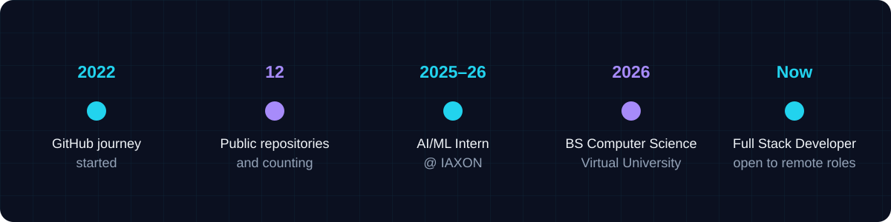

  

  

## ⚡ About Me

Hi, I'm **Ali Raza** — a **Full Stack Developer** from Pakistan who builds intelligent, data-driven web applications end to end: from databases and APIs to models and the deployed product.

- 🎓 **BS Computer Science**, Virtual University of Pakistan (2022–2026)
- 🤖 **AI/ML Intern** at IAXON (2025–2026) — data preprocessing, model training, and optimization
- 💻 **Computer Operator** at Al Islah Institute, Muzaffargarh
- 📍 Based in **Muzaffargarh, Pakistan** — open to remote roles
- 🎯 Targeting junior **Full-Stack, Data, ML, and Python** roles

  

## 🛠️ Tech Stack

**Languages & Databases**

**AI / ML & Data**

**Web & Scraping**

## 🚀 Selected Projects

| Project | What it does | Stack |
|---|---|---|
| Smart School Management System | Complete system with role-based portals for admins, teachers, and students | PHP, MySQL |
| CNN Image Models | Deep learning models for image tasks | Python, CNN |
| OCR Software | Extracts text from images/documents | Python, OCR |
| Sentiment Analysis Tool | Analyzes sentiment in text data | Python, NLP |
| Predictive Analytics | Data-driven forecasting and analysis | Python, SQL |
| Programmer's Den Website | Professional website for a software house | Web |

## 📈 GitHub Journey

  

  

<b>📌 More about me (click to expand)</b>

 

**Experience**
- AI/ML Intern — IAXON (2025–2026)
- Computer Operator — Al Islah Institute, Muzaffargarh (present)
- Home Tutor (present)

**Certifications**
- Generative AI Literacy — SkillUP by Simplilearn (SkillQuest), passed 25/25 (October 2026)

**What I do**
- Full-stack web apps (PHP, Flask, MySQL, WordPress)
- Machine learning & deep learning models (CNN, NLP, OCR)
- Data analysis & dashboards (SQL, Power BI)
- Web scraping & automation (Selenium, BeautifulSoup)

## 🤝 Connect With Me

> 💡 I build custom machine learning and deep learning models — check out my work and get in touch!

  

