  

## 👋 About Me

Hi, I'm **Ali Raza** — a Computer Science graduate from Pakistan, working at the intersection of **AI/ML, full-stack web development, and data analysis**. I build intelligent, data-driven web applications end to end: from data and models to the deployed product.

- 🎓 **BS Computer Science**, Virtual University of Pakistan (2022–2026)
- 🤖 **AI/ML Intern** at IAXON (2025–2026) — data preprocessing, model training, and optimization
- 💻 **Computer Operator** at Al Islah Institute, Muzaffargarh
- 📍 Based in **Muzaffargarh, Pakistan** — open to remote roles
- 🎯 Targeting junior **Data / ML / Python** and **Full-Stack Developer** roles

## 🛠️ Skills

**Languages & Databases**

**AI / ML & Data**

**Web & Scraping**

## 🚀 Selected Projects

| Project | What it does | Stack |
|---|---|---|
| Smart School Management System | Complete system with role-based portals for admins, teachers, and students | PHP, MySQL |
| CNN Image Models | Deep learning models for image tasks | Python, CNN |
| OCR Software | Extracts text from images/documents | Python, OCR |
| Sentiment Analysis Tool | Analyzes sentiment in text data | Python, NLP |
| Predictive Analytics | Data-driven forecasting and analysis | Python, SQL |
| Programmer's Den Website | Professional website for a software house | Web |

## 🏆 Certifications

- **Generative AI Literacy** — SkillUP by Simplilearn (SkillQuest), passed 25/25 (October 2026)

## 📊 GitHub Stats

  
  

  

## 🤝 Connect With Me

> 💡 I build custom machine learning and deep learning models — check out my work and get in touch!

  

